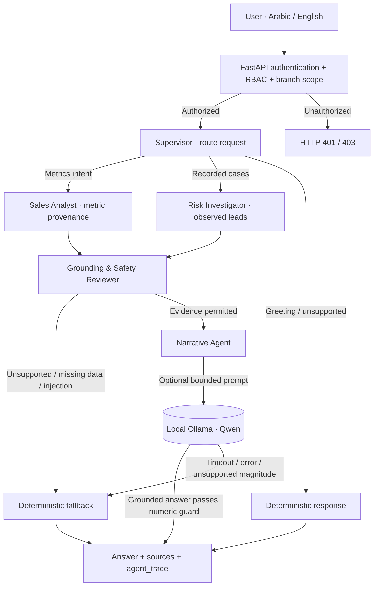

# COTTONIL NEXUS AI — Bounded Multi-Agent Copilot

**Engineering case study | Training / portfolio prototype | October 29, 2026**

> **Status:** Implemented and backend-tested role-based workflow. NOT a production-certified autonomous multi-agent platform. All business figures in the included demonstration fixture are **SYNTHETIC**, not company results. Live Ollama and real company data were **not tested in this delivery environment**.

## 1. Executive summary

COTTONIL NEXUS AI turns a bilingual question into an evidence-constrained answer through a small, observable sequence of specialized software agents. Deterministic specialists perform routing, sales provenance checks, investigation review, and grounding policy. A single optional local Ollama model handles **narrative generation only**. The backend remains the authority for identities, authorization, evidence selection, numbers and source trust. The LLM never receives a SQL executor, write tools, credentials or unrestricted file access.

**Engineering objectives:** transparency, low local hardware requirements, source-grounded answers, simple failure behavior, testable authorization, and reproducibility on a training laptop.

## 2. Solution diagram



**Trust boundary:** existing FastAPI authentication and branch checks execute before `agent_workflow.run`. The workflow cannot confer privileges; branch-scoped business Copilot calls still fail closed until their underlying evidence tools become scope-aware.

## 3. Agent contract and ownership

| Agent | Purpose | Allowed capabilities | Explicitly forbidden |
|---|---|---|---|
| **Supervisor** | Route supported user intents | Deterministic routing to existing read-only Copilot selectors | SQL generation, permission changes |
| **Sales Analyst** | Verify the metric payload before presentation | Read authorized metric selection, check finite values, source and trust labels | Recalculate unverified monetary losses, fabricate metrics |
| **Risk Investigator** | Review actual recorded cases | Recorded case IDs, status, leads, evidence references | Invent a case, assert that hypotheses are proven |
| **Grounding & Safety Reviewer** | Decide whether LLM generation is permitted | Evidence sufficiency and prompt-injection guard; fixed policy | Execute user text as a tool or grant writes |
| **Narrative Agent** | Produce Arabic/English phrasing | Deterministic answer or **one** optional Ollama chat completion | General-purpose tools, SQL, data mutations |

The agents are **software roles with independent behavior and tests**, not five independently trained/fine-tuned foundation models, not a LangGraph dependency, and not a self-directed “agent swarm.” This distinction is intentional for a lightweight, dependable demo.

## 4. Runtime sequence

1. `POST /api/copilot/chat` validates schema, context ID, and authentication. If a caller is branch-restricted, organization-wide analytics tools remain unavailable (403). **No agent can override this.**
2. The Supervisor recognizes simple greetings/language changes; these do not invoke Ollama. Otherwise it invokes the existing allowlisted read-only evidence selection code.
3. The specialized Sales or Risk agent validates the type of retrieved record. Missing case lists are surfaced as **no recorded cases**, not fictional NEX tickets. Sales metrics require a source label, finite value and trust metadata.
4. The reviewer blocks LLM calls for missing/unsupported evidence, ambiguous case references, exact unverified losses and recognized prompt-injection patterns.
5. On eligible requests, the Narrative Agent sends a bounded prompt with selected evidence to the configured Ollama OpenAI-compatible endpoint. Existing numeric-grounding checks reject unsupported larger numeric claims; this **does not guarantee full factual correctness**.
6. Fallback returns the deterministic evidence-first answer when generation fails. The API returns `mode`, `llm_used`, `sources`, `metrics`, `cases`, `limitations`, and `agent_trace`.

## 5. API specifications

**Read-only metadata (authenticated when auth is enabled)**

`GET /api/copilot/agents`

Returns `architecture`, `agents`, `llm_roles`, and `read_only`. This is documentation metadata, not an agent tool-invocation endpoint.

**Question endpoint (existing contract preserved)**

```http
POST /api/copilot/chat
Content-Type: application/json
```

```json
{
  "question": "What are the business risks?",
  "language": "en",
  "page": "ai",
  "history": []
}
```

Additional response field:

```json
{
  "agent_trace": [
    {"agent":"supervisor", "status":"completed", "detail":"Bounded read-only route chosen."},
    {"agent":"risk_investigator", "status":"completed", "detail":"Recorded case evidence checked."},
    {"agent":"grounding_reviewer", "status":"completed", "detail":"Evidence is eligible for a read-only explanation."},
    {"agent":"narrative", "status":"fallback", "detail":"Model unavailable or output rejected."}
  ]
}
```

This is a **representative schema example**, not a claim that a model ran. Trace statuses are emitted by executable workflow branches. The `agent_trace` intentionally omits prompts, passwords, user identifiers, SQL, raw datasets and secrets. The UI displays an expandable **AI Agent Workflow** panel below the answer with translated names and observed statuses.

## 6. Data flow and governance

- **Read tools:** the existing parameterized, fixed SQL selectors in `backend/app/copilot.py`. No free-form SQL execution; no callable general tool registry is supplied to Ollama.
- **Trust and quality:** `metrics.trust`, source names, investigation `observations`, `hypotheses_not_facts`, and `case_detection` rules. Hypotheses are never counted as measured losses.
- **Data-free behavior:** business questions return missing-data responses, and the analysis chain must not manufacture numbers. A no-cases state does not imply a risk-free business.
- **Tenant/branch boundary:** existing authorization runs before the agents. Branch-scoped users can still greet the Copilot, but cannot use organization-wide case/metric evidence tools.
- **Multi-turn:** conversation history is bounded, caller-supplied and used only for reference/language context, not as evidence or an authority override.
- **Sensitive data:** company datasets, real business metrics and production credentials are intentionally **not** bundled.

## 7. Security controls and residual risks

| Threat | Implemented control | Remaining risk |
|---|---|---|
| User asks for branch information outside their scope | Branch gate blocks unscoped analytics before workflow | Not yet branch-aware Copilot business analytics |
| Prompt injection | Regex detection + tool-free LLM interface + bounded evidence | Regex is heuristic; adversarial text may evade it |
| Model hallucinates amounts | Numeric claim rejection + deterministic fallback | Unverifiable qualitative statements can still slip through |
| Missing data / bogus investigations | Evidence selector + case-presence gate + deterministic response | Investigation predicates are heuristic, not formal reconciliation |
| Model offline | Graceful deterministic fallback with truthful `llm_used=false` | Live Ollama availability must be checked locally |
| Data exfiltration through agent tools | No arbitrary model tools or SQL execution | Endpoint URLs and wider network access must be protected in deployment |
| Audit / trace privacy | Small allowlisted step events; legacy audit/auth controls persist | No distributed tracing / SIEM proof-of-integrity in this prototype |

## 8. Test and validation evidence

**Backend command:**

```bash
PYTHONPATH=backend python -m pytest backend/tests -q
```

Tests in `backend/tests/test_agent_workflow.py` cover metadata and tool restrictions, empty-database behavior, synthetic metric provenance, case grounding, missing-case semantics, prompt injection, rejected unknown provenance, mocked Ollama narrative, and branch-scope denial. The optional synthetic demo seeding script is tested for isolation and non-overwrite behavior.

**Not yet established by these tests:** live Ollama model generation on Windows, model latency/GPU footprint, React production build, Playwright browser screenshots, production hardening, adversarial security certification, or real Cottonil data correctness. Consult `docs/QA_REPORT.md` for current release checks.

## 9. Local live demo — reproducible and clearly labeled

Run the **isolated synthetic data fixture** from the repository root (only if you have not already prepared approved demo data):

```powershell
py scripts\seed_synthetic_demo.py
```

It creates `data/demo_synthetic/raw/` and `data/demo_synthetic/demo.sqlite` **only if the target does not already exist**, and never replaces the normal data store. It uses a deliberately tiny fixture of **12 fabricated orders, EGP 1,200 in fabricated net sales, and 24 fabricated units**. Do not present those as Cottonil results.

Update the local, ignored `.env` to point to the **absolute** `NEXUS_DB` and `NEXUS_RAW` paths printed by the script. Enable local Ollama using `scripts/enable_ollama_demo.ps1`, then start using `scripts/start_windows.ps1`. The Windows launcher reads `.env` into its process before starting FastAPI. **Never commit `.env`.**

Live sequence:

1. Ask `Hello` → supervisor + narrative greetings; no LLM or business evidence.
2. Ask `What is the net sales in the synthetic demo?` → Sales Agent + reviewer + optional local Ollama Narrative; inspect trust/source labels.
3. Ask `What business investigations are recorded in the synthetic demo?` → Risk Agent + reviewer; case IDs and source links. Mention unresolved hypotheses explicitly.
4. Ask `What is the exact confirmed financial loss?` → Reviewer deliberately blocks LLM and gives evidence-only denial.
5. Expand **View AI Agent Workflow** for each reply. Show which roles ran and whether LLM generation or fallback occurred.

If the answer is `deterministic-fallback`, **do not** say that Ollama generated it. Use a `grounded-llm` answer with `llm_used=true` as proof that the model participated. This is a training prototype, not a claim of real client deployment.

## 10. Portfolio-ready technical summary

> **Designed and implemented a bounded multi-agent, bilingual retail intelligence Copilot using FastAPI + React and optional local Ollama.** A deterministic supervisor coordinates specialized sales, risk-investigation and grounding review roles before a narrative generation role. The architecture enforces existing RBAC boundaries, uses source-provenanced analytics, exposes per-response execution traces, and falls back safely when evidence or model access is unavailable. Demonstrations use explicitly synthetic datasets; production and real-client validation remain future work.

**Code map:** `backend/app/agent_workflow.py`, `backend/app/copilot.py`, `backend/tests/test_agent_workflow.py`, `frontend/src/components/Copilot.tsx`, `scripts/seed_synthetic_demo.py`.
